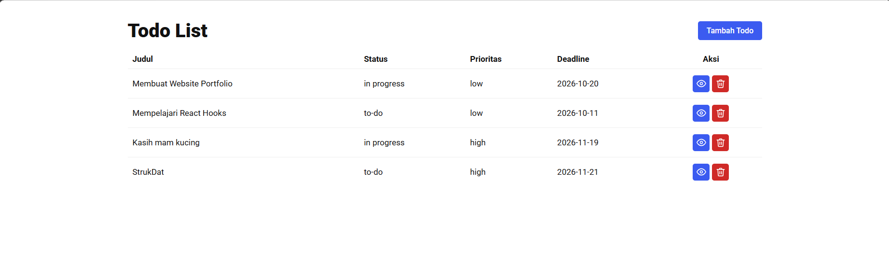
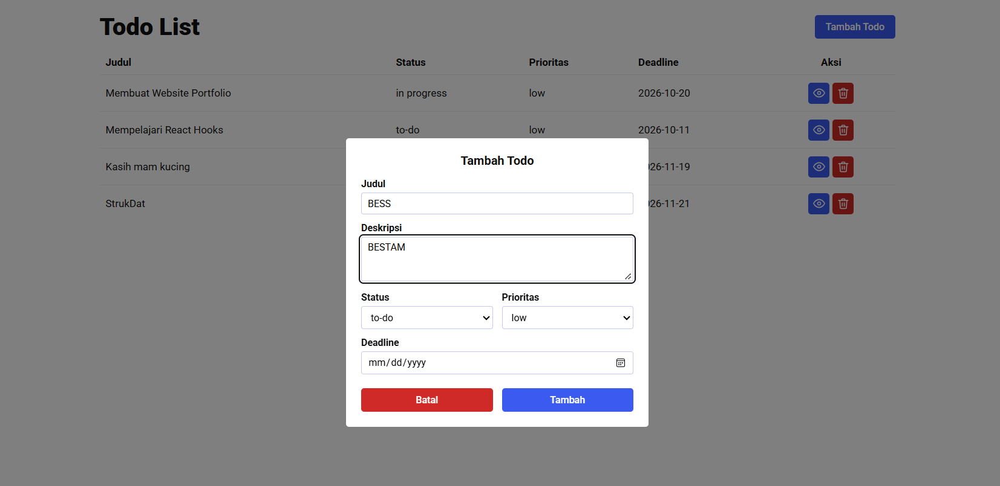
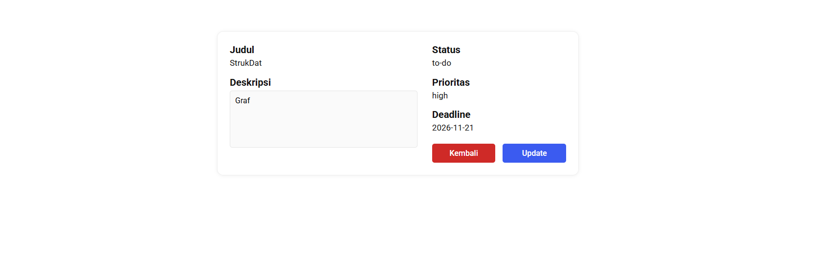
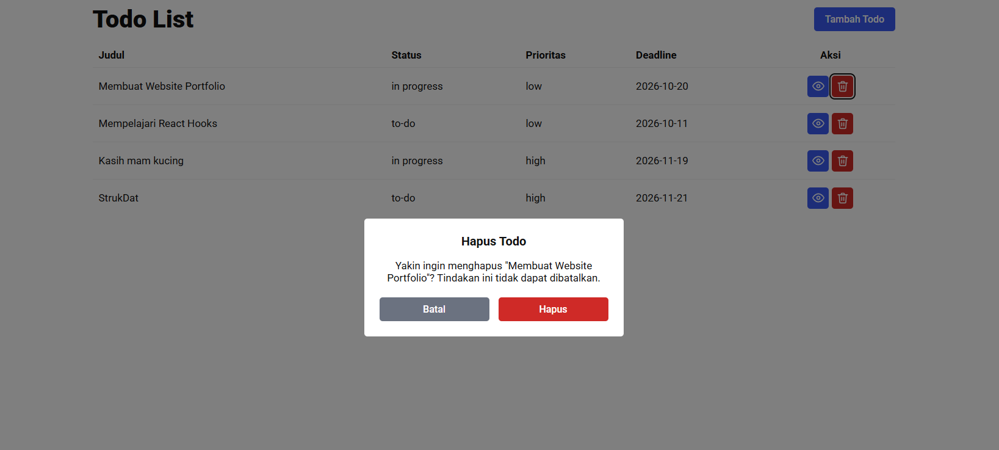

# Todo List - React.js

**Nama:** Ridho Pandapotan
**NIM:** 251401142
**Mata Kuliah:** Praktikum Pemrograman Web

Kuis praktikum: aplikasi To-Do List dengan React.js 

## Fitur
- Melihat daftar tugas
- Melihat detail tugas
- Menambah tugas lewat form
- Mengubah tugas yang sudah ada
- Menghapus tugas (ada konfirmasi dulu)
- Notifikasi setelah tambah, ubah, dan hapus

## Cara Menjalankan
npm install
npm run dev
Lalu buka http://localhost:5173

## Screenshot

### Daftar Tugas

### Tambah Tugas

### Detail Tugas

### Update Tugas

### Konfirmasi Hapus

